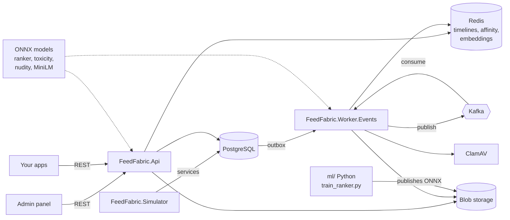

<p align="center">
  
</p>

<h1 align="center">FeedFabric</h1>

<p align="center">
  <b>An open-source feed engine with ranking you can tune.</b><br>
  Timelines with fan-out, a learned For You ranker, ranking profiles you shape in a live studio, and content safety
  that runs on your own servers. Written in C#.
</p>

<p align="center">
  
  
  
  
  
  
  
  
  <a href="LICENSE"></a>
</p>

---

## Features

- **Posts, comments, likes, reposts and follows**, with nested replies, `#hashtags`, inferred topics and `@mentions`.
- **Following and For You feeds.** Following is a Redis timeline per user, filled by fan-out on write. For You draws candidates from four sources (network, popular in your topics, similar readers, similar meaning) and ranks them.
- **A learned ranker.** LightGBM predicts five outcomes per post (open, like, comment, long read, skip), runs in C# through ONNX Runtime on CPU, and falls back to a scoring formula when no model is loaded.
- **Favourites.** Up to 30 accounts someone never wants to miss: always considered for For You, lifted above everyone
  else, and a feed of their own.
- **Healthy feeds.** It caps posts per author and per topic in a row, adds exploration slots, and supports *Not interested* and *Show more*.
- **Ranking profiles.** Every part of For You is a setting: sources, goals, your own scoring formula, freshness, variety, exploration, boosts and filters. Six presets come built in, and the **Feed studio** previews changes live before you save a new version.
- **Content safety, all on your own servers:**
  - **Text:** rules (blocked terms, link spam, flooding) plus a toxicity classifier. Rule breaks and threats are blocked; severe abuse, hate and sexually explicit text are held, visible only to their author until a moderator approves or removes them in the admin app. Insults aimed at someone ("you idiot", not "grinning like an idiot") are flagged: published, and put in the review queue. Members can report posts and comments, and three reports hold one for review.
  - **Photos:** ClamAV scan (on by default; `MalwareScanning:Enabled` turns it off), file-type sniffing, a rebuild that strips EXIF, and a nudity classifier.
  - **Failure handling:** if a check can't run, the post is blocked.
- **Events through an outbox to Kafka**, with idempotent consumers and separate consumer groups for fan-out, engagement, media and embeddings.
- **Pluggable blob storage:** local disk in development, or any S3-compatible service (S3, R2, MinIO, LocalStack).
- **A simulator** that populates the system with 1,000 users, British English conversations and realistic reading behaviour.
- **An admin panel** for running it: a live dashboard, a review queue, reports, the moderation log, users and posts (suspend, verify, approve, remove), the Feed studio, and the server's settings and models.

## Architecture



| Project | What it does |
|---|---|
| `src/FeedFabric.Api` | REST API, feed ranking and text moderation |
| `src/FeedFabric.Application` | Domain, EF Core, services, ranking and safety |
| `src/FeedFabric.Worker.Events` | Outbox publisher and Kafka consumers: fan-out, engagement, media scanning, embeddings |
| `src/FeedFabric.Simulator` | Seeds users and backfills conversations for a demo; optionally keeps posting, reading and engaging in real time |
| `web/admin` | Vue 3 admin panel: dashboard, moderation, users, posts, Feed studio and system settings |
| `web/fabric-ui` | FabricUI: the Vue 3 components and design tokens the admin panel is built with |
| `ml/` | Ranker training, synthetic conversation generator and model downloads (Python, `uv`) |
| `tests/` | xUnit tests |

## Quick start

You need Docker, the .NET 10 SDK, Node 22+ and [uv](https://docs.astral.sh/uv/).

```bash
cp .env.example .env
make models      # download the safety and embedding models (once)
make up          # Postgres, Kafka, Redis, API and worker
make backfill    # seed users and backfill 60 days of conversations (fresh database only), then stop
make admin       # the admin panel at http://localhost:5185
```

Open **http://localhost:5185** for the dashboard: platform engagement, ranking experiments and safety. In Development any user can sign in to the panel; elsewhere it needs a staff role from your identity provider ([docs/auth.md](docs/auth.md)).

After the simulator has run for a while, run `make train` to train the For You ranker. The API picks up the new model within a minute. On a Mac, LightGBM first needs `brew install libomp`.

> **Rider:** the *FeedFabric: All* run configuration starts the infrastructure in Docker and runs the API, worker and simulator on your machine.

## Commands

| Command | What it does |
|---|---|
| `make up` / `make down` / `make down-all` | Start everything; stop the app containers; stop everything (data is kept) |
| `make run` / `make run-worker` | Run the API or worker on your machine against Compose |
| `make backfill` | Seed users and backfill demo history on a fresh database, on your machine at low priority, then stop |
| `make simulate` / `make simulate-stop` | Start or stop the simulator in Docker (`Simulator__Live=true` keeps it posting after the backfill) |
| `make admin` / `make admin-build` | Run the admin panel with hot reload at http://localhost:5185; build it as a static site into `web/admin/dist` |
| `make docs` | The docs site at http://localhost:5186: how it all works, and a guide to building a front end on the API (`web/docs`) |
| `make openapi` | Save the running API's OpenAPI document into the admin panel's API reference (`web/admin/public/openapi.json`) |
| `make models` | Download the pretrained models into `.blobs/models` |
| `make tune-toxicity` | Fine-tune the offensive-language model on this app's wording and publish it to `.blobs` (about 45 minutes) |
| `make train` | Train the ranker on the feed log and publish it as ONNX |
| `make migration name=AddX` / `make migrate` | Create or apply an EF Core migration (the API also migrates on startup in development) |
| `make logs` / `make logs-worker` / `make psql` / `make redis` | Logs and shells |

## API

All routes need a bearer token from your identity provider: Auth0, Entra ID, Cognito, Keycloak, or your own OpenID Connect server. FeedFabric has no accounts of its own; it checks the token and creates the user on their first request. See [docs/auth.md](docs/auth.md) to plug in yours. In development, send `X-Dev-User: <externalUserId>` instead.

| Area | Routes |
|---|---|
| Feeds | `GET /userfeed/home` (Following), `GET /userfeed/foryou?profile=<key>`, `GET /userfeed/favourites`, `GET /userfeed` (your own posts) |
| Posts | `POST /userfeed/posts`, `PUT`/`DELETE /userfeed/posts/{id}` |
| Comments | `GET`/`POST /userfeed/posts/{id}/comments`, `GET /userfeed/comments/{id}/replies`, `DELETE /userfeed/comments/{id}` |
| Likes | `PUT`/`DELETE /userfeed/posts/{id}/like` |
| Reposts | `PUT`/`DELETE /userfeed/posts/{id}/repost` |
| Reports | `POST /userfeed/posts/{id}/report`, `POST /userfeed/comments/{id}/report` |
| Moderation (`moderator` role) | `GET /admin/moderation/overview`, `/queue`, `/reports`, `/log`; `POST /admin/moderation/posts/{id}/decision`, `/comments/{id}/decision` |
| Users and posts (`moderator` role) | `GET /admin/users`, `GET /admin/users/{externalUserId}`, `PUT /admin/users/{externalUserId}/status`, `PUT /admin/users/{externalUserId}/verified`, `GET /admin/posts`, `GET /admin/posts/{id}` |
| Staff (`moderator` or `ranking-admin`) | `GET /admin/me`, `GET /admin/dashboard`, `GET /admin/system` |
| Signals | `POST /userfeed/impressions`, `POST /userfeed/dwell`, `POST /userfeed/posts/{id}/open`, `POST /userfeed/posts/{id}/not-interested`, `POST /userfeed/posts/{id}/show-more` |
| Tags and mentions | `GET /userfeed/tags/trending`, `GET /userfeed/tags/{tag}/posts`, `GET /userfeed/mentions` |
| Follows | `PUT`/`DELETE /follows/{externalUserId}` |
| Favourites | `GET /favourites`, `PUT`/`DELETE /favourites/{externalUserId}` (up to 30) |
| Media | `POST /media/uploads`, `POST /media/{id}/complete`, `GET /media/{id}` |
| Ranking profiles | `GET /ranking/profiles`, `GET`/`PUT`/`DELETE /ranking/profiles/{key}`, `GET /ranking/profiles/{key}/versions`, `POST /ranking/preview`, `GET /ranking/vocabulary` |

Errors are [RFC 9457 Problem Details](https://www.rfc-editor.org/rfc/rfc9457) with a stable `code`. See [docs/errors.md](docs/errors.md) for the list.

## Ranking

Every post served is logged in `FeedLog` with the features the ranker saw and the position it was shown at, then marked as the reader sees, opens, likes, comments on, reads or skips it. `ml/train_ranker.py` trains one LightGBM model per outcome and combines them into one value:

```
value = 0.5·open + 1·like + 3·comment + 2·long_read − 1.5·skip
```

It's evaluated on the newest 20% of the data against the formula (NDCG@10 and AUC). Explored rows are weighted by their propensity. The model is exported to ONNX and published to blob storage.

The trainer uses `--source real` by default, which excludes simulated users. `make train` uses `--source all` for development. Models trained on synthetic data are labelled on the dashboard and shouldn't be served to real members.

## Ranking profiles

A profile is a named, versioned set of settings that decides how For You is put together. It borrows the idea of candidate sources and a scoring formula from feed services like Stream, and keeps FeedFabric's learned model, variety rules and logging.

| Part | What you can set |
|---|---|
| **Sources** | People you follow, your topics, people like you and similar meaning: each on or off, with how many posts it adds and how far back it looks |
| **Scoring** | The trained model, weighted by your **goals** (opens, likes, comments, long reads, skips); the built-in formula; **your own formula**; or newest first |
| **Freshness** | An extra half-life on top of the ranker, and a maximum age |
| **Variety** | Posts per author in any ten, the same topic in a row, a minimum from outside your follows, and the penalty for posts already seen |
| **Exploration** | Slots per ten for posts the ranker wouldn't have picked, and how far down they come from |
| **Boosts** | Multiply scores by tag, author, photos, whether you follow the author, or whether they're one of your favourites (0 sinks a post) |
| **Filters** | Leave out tags, show only some tags, photos only, a minimum number of likes |

**Your own formula** is a small, safe expression language: it can only read the ranking signals and call the functions below, so a profile can't run anything else.

```
model * decay_exp(age_hours, 12)                           the model, halving every 12 hours
log1p(likes + 2 * comments) * decay_exp(age_hours, 6)      popular now
if(topic_match > 0.2, formula, formula * 0.2)              mostly your topics
```

- **Variables:** every ranking signal (`likes`, `comments`, `topic_match`, `semantic_match`, `velocity_30m`…), plus `age_hours`, `formula` (the built-in score) and `model` (the trained model's value with your goals).
- **Functions:** `decay_exp`, `decay_linear`, `decay_gauss`, `min`, `max`, `clamp`, `if`, `ln`, `log1p`, `sqrt`, `exp`, `abs`.
- **Operators:** `+ - * / ^`, comparisons and `and`/`or`/`not`.
- `GET /ranking/vocabulary` lists them all with descriptions.

**Presets:** `balanced` (the default), `community`, `discovery`, `following-first`, `fresh` and `newest`. They're read-only; *Save as* makes your own copy under a new key.

**Saving adds a version.** Every feed served is logged with the profile that built it (`running-club@3`), so the dashboard compares profiles and versions on real engagement. Set `Ranking:DefaultProfile` to change the default. Pick one per request with `?profile=`, or split the simulator's readers between several with `Simulator:ForYouProfiles`.

**Feed studio** (in the admin panel):
- choose a profile, change any setting, and watch the preview update for any user
- each post shows how far it moved against the saved version
- a summary compares the mix: share from people you follow, author variety, age and photos

Outside Development, the profile endpoints need the `ranking-admin` role.

## Models

| Job | Model | Runs in |
|---|---|---|
| For You ranking | LightGBM, trained in `ml/` | API |
| Offensive language | [`unitary/unbiased-toxic-roberta`](https://huggingface.co/unitary/unbiased-toxic-roberta), Detoxify's `unbiased` model (ONNX by onnx-community), fine-tuned on this app's wording by `make tune-toxicity` | API |
| Nudity | [`Falconsai/nsfw_image_detection`](https://huggingface.co/Falconsai/nsfw_image_detection) (8-bit ONNX by onnx-community) | Media worker |
| Meaning similarity | [`all-MiniLM-L6-v2`](https://huggingface.co/sentence-transformers/all-MiniLM-L6-v2) | Embeddings worker |

All of them run with ONNX Runtime on CPU. Versions are pinned in `ml/fetch_models.py`. As published, the offensive-language model reads sport talk as violence ("kill it at the race" scores as a threat), so `make tune-toxicity` fine-tunes it on this app's wording and only publishes it if it passes its tests (`ml/tune_toxicity.py`).

## Simulated data

On an empty database the simulator backfills 60 days of history through the real services, so moderation, tagging, events and fan-out all run. The history comes from a synthetic, British English conversation library (`ml/generate_conversations.py`): questions answered by members on the same topic, milestones congratulated, and open discussions. None of it comes from real people.

Each simulated user has a main interest and one or two secondary interests. Then it stops. With `Simulator:Live` set to `true` it keeps going, posting and reading every second; that runs the safety models and ranks feeds nonstop, so expect it to keep a laptop busy. Even-numbered users read For You and odd-numbered users read Following, so the dashboard can compare the two. Settings are in `src/FeedFabric.Simulator/appsettings.json`.

## Docs

- [Configuration](docs/configuration.md): every setting and environment variable, and which service reads it
- [Data model](docs/data-model.md): every entity and field, and the event flow
- [API errors](docs/errors.md): codes, statuses and validation errors

## Licence

[MIT](LICENSE). The pretrained models keep their own licences (Apache-2.0); see the links in [Models](#models).
